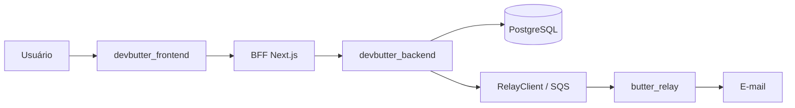

# Recuperação de senha do portal — Slice 0

## Escopo e fronteiras

Este contrato atende usuários existentes do portal. Ele não substitui, remove
nem renomeia `password-setup`, que permanece exclusivo do onboarding de contas
sem senha.

O navegador só conversa com o BFF. O backend é a autoridade de usuário, token,
expiração, senha e autorização; o Relay apenas entrega o e-mail.

## APIs congeladas

### Backend

| Método e rota | Entrada | Sucesso | Falha pública |
|---|---|---|---|
| `POST /accounts/password-recovery` | `{ "email": "cliente@example.com" }` | `202 { "message": "Se o e-mail estiver cadastrado, enviaremos instruções." }` | Mesmo `202` e corpo para e-mail inexistente, inativo ou admin |
| `GET /accounts/password-recovery/{token}` | token no caminho | `200 { "valid": true }` | `404 { "detail": "Link inválido, expirado ou já utilizado" }` |
| `POST /accounts/password-recovery/complete` | `{ "token": "...", "password": "..." }` | `200 TokenPair` | Erro genérico de token; `422` para senha com menos de oito caracteres |

`TokenPair` só trafega entre backend e BFF. O backend não retorna e-mail ou
outro dado do usuário ao validar o link.

### BFF

| Método e rota | Sucesso ao navegador | Falha ao navegador |
|---|---|---|
| `POST /api/portal/auth/password-recovery` | Mesmo `202` e mensagem genérica do contrato | Mesmo `202` e mensagem genérica |
| `GET /api/portal/auth/password-recovery/{token}` | `200 { "valid": true }` | `404 { "error": "invalid_or_expired" }` |
| `POST /api/portal/auth/password-recovery/complete` | `200 { "ok": true }`; grava os cookies atuais `httpOnly` | Erro genérico, sem URL interna, token ou senha |

Os handlers usam `API_BASE_URL` apenas no servidor, `cache: "no-store"` e
encaminham somente os campos do contrato.

## Decisões aprovadas

- TTL: 45 minutos.
- Um novo pedido invalida tokens anteriores ainda válidos do mesmo usuário.
- A troca de senha invalida todas as sessões atuais do usuário.
- Limite: cinco pedidos por e-mail e dez por IP em 15 minutos; a resposta
  continua idêntica quando o limite é atingido. IP só pode ser obtido de proxy
  confiável, nunca de cabeçalho fornecido livremente pelo cliente.
- Administradores usam fluxo separado. Esta rota responde genericamente e não
  envia recuperação para contas administrativas.

## Requisitos de segurança para as próximas slices

- Gerar token com CSPRNG; persistir exclusivamente seu hash, `user_id`,
  `expires_at`, `used_at` e timestamps. Nunca registrar token bruto, senha ou
  link completo.
- Consumir o token junto com a troca de senha em uma transação lógica, com
  condição atômica de `used_at IS NULL` e expiração válida.
- Aplicar senha mínima de oito caracteres no BFF e no backend; reutilizar o
  mecanismo atual de hash de senha.
- Publicar pelo `RelayClient` usando `devbutter_password_recovery`, com apenas
  nome, link HTTPS e prazo no payload. O template precisa estar registrado no
  projeto `devbutter-platform`; esse registro é uma pendência operacional.
- A invalidação de todas as sessões não existe no JWT stateless atual. A Slice
  2 deverá introduzir e verificar uma estratégia de revogação/versionamento;
  trocar somente `password_hash` não invalida tokens já emitidos.

## Evidência e limites da Slice 0

Este documento foi confrontado com o fluxo atual de `password-setup`, o BFF do
portal, `NotificationService` e `RelayClient`. Nenhum endpoint, migration,
template de Relay, rate limiter ou mecanismo de revogação foi implementado ou
validado nesta slice.

## Status da Slice 1

`POST /accounts/password-recovery` foi implementado com `202` uniforme,
normalização de e-mail, token CSPRNG armazenado somente como hash, TTL de 45
minutos, invalidação dos tokens válidos anteriores e publicação pelo
`RelayClient`. A tabela é separada de `password_setup_tokens`, portanto esses
tokens não são aceitos pelo fluxo de onboarding.

Os testes cobrem e-mail existente/inexistente, usuário inativo/admin, ausência
do token bruto na persistência, publicação apenas do caso válido e invalidação
na repetição. Rate limit por IP/e-mail, registro do template no Relay, BFF,
validação/conclusão e revogação de sessões continuam fora desta slice.

## Status da Slice 2

`GET /accounts/password-recovery/{token}` retorna somente `valid`; a conclusão
valida senha mínima, atualiza a senha e consome o token por atualização
condicional na mesma transação. Token inexistente, expirado, usado, de usuário
inativo/admin ou sem conta retorna a mesma resposta `404` genérica.

`users.session_version` é carregado nos JWTs e conferido em REST, refresh e
Socket.IO. A troca de senha incrementa a versão e invalida todas as sessões
emitidas anteriormente. Testes locais cobrem sucesso, expiração, reuso,
concorrência com uma vencedora, senha inválida, usuário inativo/sem conta e
revogação de access token, refresh token e socket já conectado.
